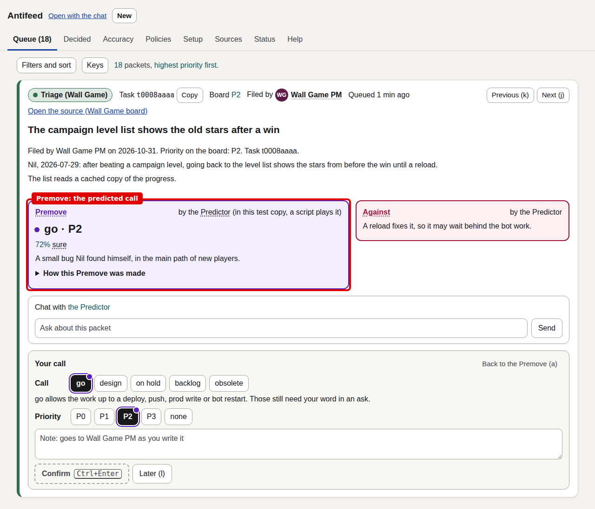
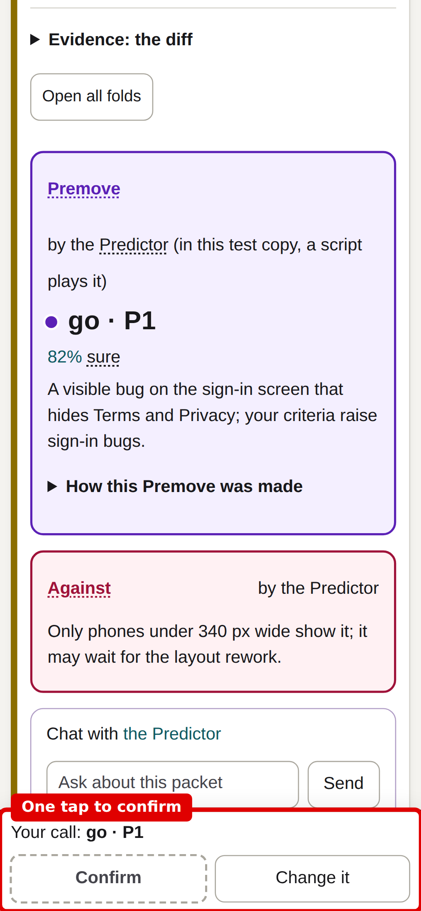
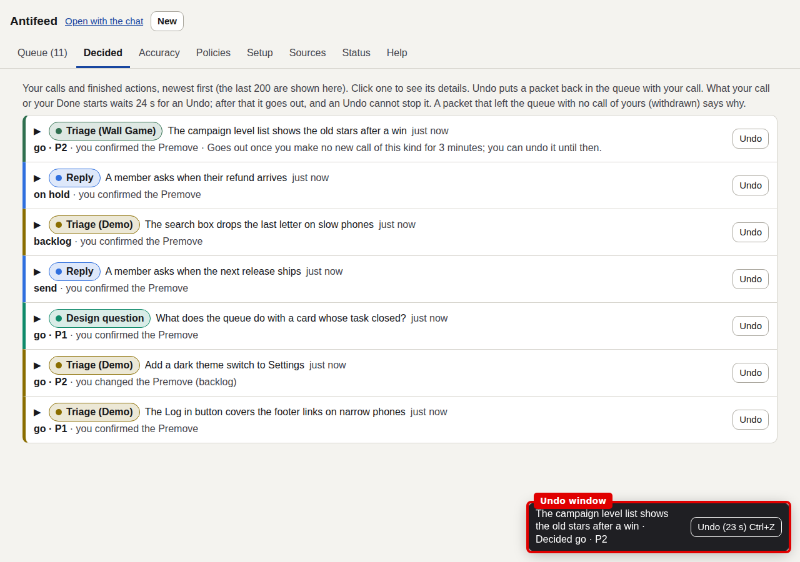
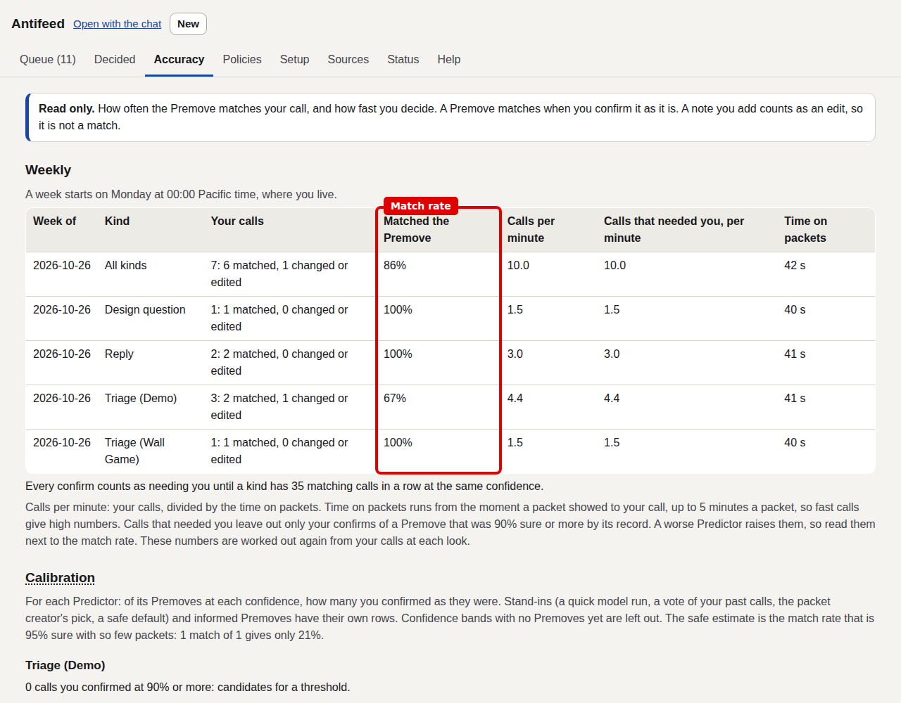

# Antifeed

Antifeed was a one-person decision queue. It is an attempt at the Decision Node from my post [The end of agents](https://nilmamano.com/blog/end-of-agents).

The feature has since moved into [Isomux](https://github.com/nmamano/isomux) itself, as asks in the Isomux Inbox: options, a recommended pick, a priority, images and diffs. So this app is obsolete. The code stays up as a reference implementation.

## The idea

Agents do the work. Every decision they cannot safely make on my behalf lands in one queue, and I sit at that queue.

- Events. Each source (a task board, a sign-off list, an inbox, a video review queue) makes one card per item that needs me.
- Decision packets. A card holds only what the call needs: the question, the evidence folded away, and the fields of my call.
- Premove. A consult agent predicts my call from my past calls, with a confidence and a reason. The prediction is pre-filled, so most cards are one key.
- Decision log. Every call is appended to a log with the packet as I saw it. A call can be undone for a few seconds.
- Actions. My call goes out as commands to agents or to the source app, held for a moment so I can take it back. Actions only I can take come as action cards.
- Accuracy. The app scores each predictor against my calls, so I can see which decisions it could make for me.

The design is in THESIS.md. DESIGN.md is the build log, round by round, with the feedback that shaped each page.

## Screenshots

Demo data, not real cards.

The same card on a phone. Most calls are one tap on Confirm.

## Running it

It runs against an Isomux office: `bun install`, then `bun run src/main.ts`. The sources, the predictors and the policies are in `projects/`. There is no reason to run it now; the Isomux Inbox does the same job.
